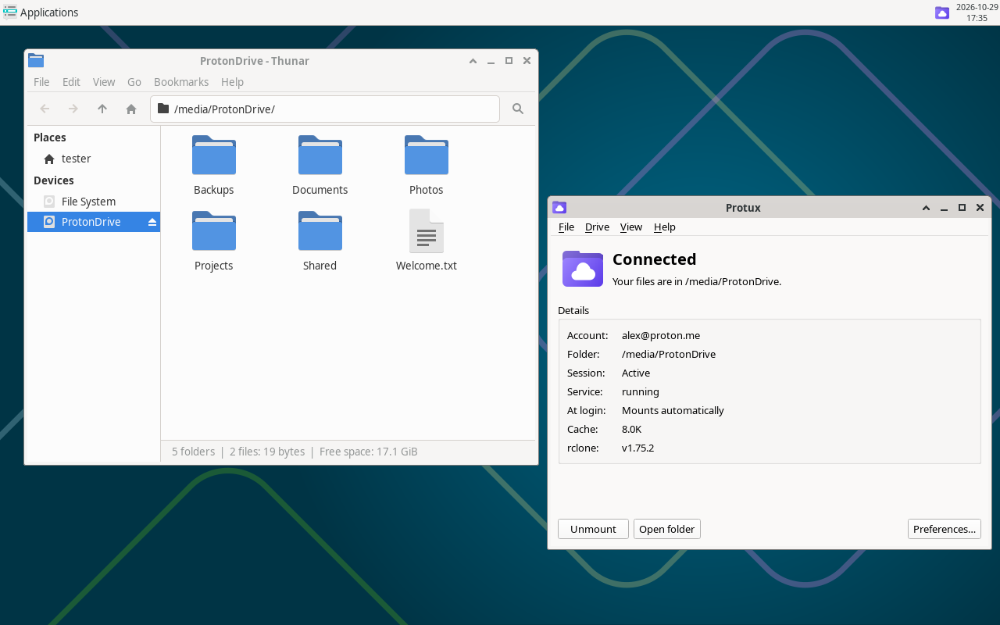
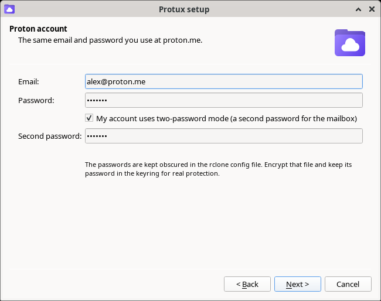
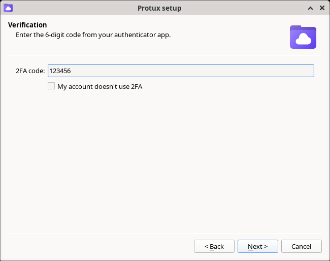
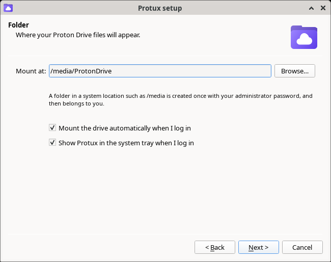
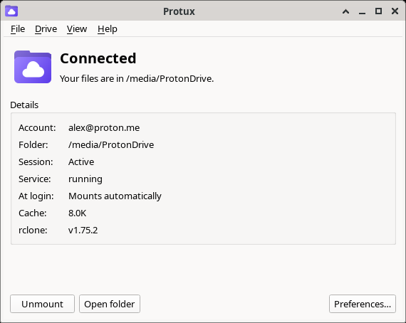
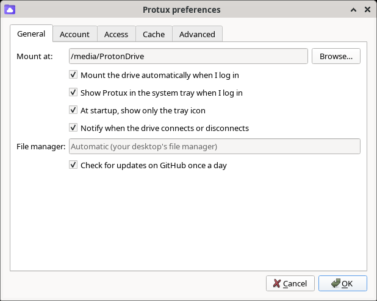
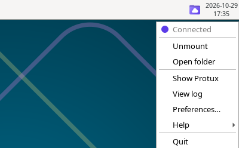
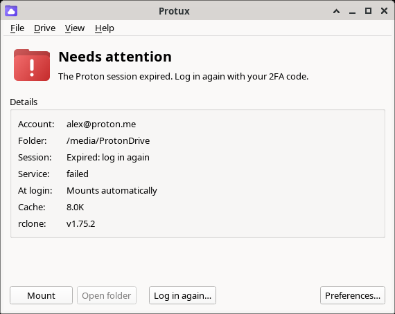
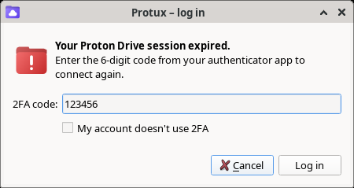

<p align="center"></p>

<h1 align="center">Protux</h1>

<p align="center"><b>Your Proton Drive on Linux — mounted at login, and it stays that way.</b></p>

<p align="center">


</p>

**Protux is an unofficial Proton Drive client for Linux.** Proton has no Linux app, so Protux
mounts your Proton Drive as a normal folder (`/media/ProtonDrive` by default) using
[rclone](https://rclone.org/protondrive/) and a systemd user service, and adds what you need to
leave it running every day: a **setup wizard**, a **system tray icon**, **2FA re-login prompts**
when the session expires, support for **two-password accounts**, and protection against the login
loops that get Proton accounts **rate-limited (HTTP 429)**.

Works on Arch, CachyOS, Manjaro, Debian, Ubuntu, Fedora and any distro with systemd, on any
desktop (GNOME, KDE Plasma, XFCE, Cinnamon, MATE…), X11 or Wayland. English and Spanish.

<p align="center"></p>

## Screenshots

| Setup wizard | Two-factor code |
|---|---|
|  |  |
| **Mount folder** | **Main window** |
|  |  |
| **Preferences** | **Tray menu** |
|  |  |
| **Session expired** | **Log in again with a new 2FA code** |
|  |  |

*Screenshots taken in a test VM with a simulated Proton account; no real account data is shown.*

## Features

- **Proton Drive as a folder** — files show up in your file manager (Thunar, Dolphin, Nautilus,
  Nemo…); *Open folder* uses your desktop's own file manager.
- **Mounted at login** — a systemd user service (`Type=notify`) that waits for the keyring and
  the network first, so programs that need the drive can start with `After=protux.service`.
- **Tray icon** — purple connected, amber connecting, grey disconnected, red needs attention.
  Mount, unmount, open the folder or renew the session from its menu.
- **Setup wizard** — email, password, second password (two-password mode), 2FA code and mount
  folder. Everything has a GUI; nothing needs a terminal.
- **2FA re-login** — when the session expires you get a notification; click it, type the 6-digit
  code and the drive comes back.
- **No account lockouts** — expired session, wrong password, CAPTCHA and HTTP 429 are detected and
  never retried in a loop; after a rate limit it asks again once the block is over.
- **Secrets stay secret** — passwords go through stdin, never on the command line; optional
  encrypted rclone config with its password in the Secret Service keyring (GNOME Keyring, KWallet,
  KeePassXC).
- **Hooks** — run scripts or start services after each mount.
- **Command line too** — `protux setup | login | status | doctor | logs …`

## Why not just `rclone mount`?

Running rclone's Proton Drive backend unattended goes wrong in predictable ways, and
Protux handles each of them:

| Problem | Protux |
|---|---|
| The session expires and needs a new 2FA code; a service that restarts on failure logs in again and again until Proton blocks the account (HTTP 429) for about an hour | Expired session and 429 are detected and **never retried**; at most 3 attempts per hour otherwise |
| Nobody notices the drive is gone | Desktop notification; clicking it opens a 2FA dialog that logs in and remounts |
| After a 429 you have to remember to come back | It asks for the code again once the block is over (65 min) |
| At boot the keyring is still locked and the network isn't up | Waits for both before trying (they don't waste attempts) |
| With lingering, units start before the desktop exists | The prompt waits for your graphical session |
| Programs that need the drive start too early | `Type=notify`: `After=protux.service` really means "mounted" |
| Passwords on the command line | Password obscured through stdin; the 2FA code goes in an environment variable |
| Two-password accounts (login password + mailbox password) | Supported in setup, login and settings; a missing or wrong second password is detected and asked for |
| Proton asks for a CAPTCHA | Detected and explained (rclone can't solve it) instead of retrying |

## Install

Download the package for your distro from the [latest release](https://github.com/FrankMncrf/Protux/releases/latest):

| Distro | Package |
|---|---|
| Arch, CachyOS, Manjaro, EndeavourOS | [protux-0.1.0-1-any.pkg.tar.zst](https://github.com/FrankMncrf/Protux/releases/download/v0.1.0/protux-0.1.0-1-any.pkg.tar.zst) · [PKGBUILD](https://github.com/FrankMncrf/Protux/releases/download/v0.1.0/PKGBUILD) |
| Debian 13 / Ubuntu 24.04+ | [protux_0.1.0-1_all.deb](https://github.com/FrankMncrf/Protux/releases/download/v0.1.0/protux_0.1.0-1_all.deb) |
| Fedora | [protux-0.1.0-1.fc44.noarch.rpm](https://github.com/FrankMncrf/Protux/releases/download/v0.1.0/protux-0.1.0-1.fc44.noarch.rpm) |
| Checksums | [SHA256SUMS](https://github.com/FrankMncrf/Protux/releases/download/v0.1.0/SHA256SUMS) |

```sh
sudo pacman -U protux-0.1.0-1-any.pkg.tar.zst      # Arch and derivatives
sudo apt install ./protux_0.1.0-1_all.deb          # Debian / Ubuntu
sudo dnf install ./protux-0.1.0-1.fc44.noarch.rpm  # Fedora
```

From source (any distro):

```sh
git clone https://github.com/FrankMncrf/Protux.git && cd Protux
sudo make install            # PREFIX=/usr by default
```

### What it uses

| Component | What for | Required |
|---|---|---|
| **rclone** ≥ 1.64 | Talks to Proton Drive and mounts it (FUSE) | yes |
| **FUSE 3** (`fuse3`) | The mount itself | yes |
| **systemd** (user session) | Mounts at login, restarts safely, `Type=notify` | yes |
| **bash**, **gawk** | The `protux` command | yes |
| **PyQt6** | Tray icon, setup wizard, window and preferences (`protux-gui`) | for the GUI |
| **polkit** (`pkexec`) | Creates `/media/ProtonDrive` once with your administrator password | for the default folder |
| **libsecret** (`secret-tool`) | Keeps the rclone config password in your keyring | optional |
| **libnotify** (`notify-send`) | Notifications when the session expires | optional |
| **zenity** or **kdialog** | 2FA prompt when the GUI isn't installed | optional |

Debian 13 and Ubuntu 24.04 ship an rclone without the Proton Drive backend; install a newer one
from [rclone.org](https://rclone.org/downloads/) and set `RCLONE=` if it isn't on `PATH`.

## Use

Open **Protux** from the applications menu (`protux-gui`). The first time, a wizard
asks for your account (email, password, second password if you use two-password mode), the 2FA
code and the folder to mount. Afterwards Protux lives in the system tray: its icon shows
the state of the drive (purple connected, amber connecting, grey disconnected, red needs
attention), and its window mounts or unmounts the drive, opens it in your file manager, renews
the session and has every setting under *Preferences*. It is a Qt app and follows your desktop's
look.

The same from a terminal:

```sh
protux setup     # remote, mountpoint, first 2FA login, autostart
protux password  # after changing your password or second password at proton.me
protux status
protux login     # when the session expires (or click the notification)
protux doctor    # something wrong?
```

Your files show up in `/media/ProtonDrive` (or any folder you choose). That folder is created
once with your administrator password (pkexec) and then belongs to you.

### Already have an rclone remote?

`setup` keeps an existing remote. Or write `~/.config/protux/config` yourself:

```sh
REMOTE=ProtonDrive
MOUNTPOINT=/media/ProtonDrive
RCLONE=/opt/rclone/rclone               # a pinned build, if a new rclone breaks Proton
KEYRING_ATTRS="application rclone purpose config-password"   # existing keyring entry
ALLOW_OTHER=yes                          # needs user_allow_other in /etc/fuse.conf
```

then `protux enable && protux start`. All settings: `config.example` or `man protux`.

### Encrypted rclone config

Recommended: the rclone config holds your Proton session. Encrypt it with
`rclone config encryption set`, then `protux keyring set` stores the password in the
Secret Service keyring (GNOME Keyring, KWallet, KeePassXC), unlocked with your session.

### Running things after the mount

Hooks in `~/.config/protux/hooks/post-mount.d/` run after each mount (see
`hook.example`). For services, use a unit:

```ini
[Unit]
After=protux.service
BindsTo=protux.service
```

## How it works

```
protux.service (Type=notify)
  └─ protux __run: wait keyring → wait DNS → rclone mount (READY=1 when mounted)
       10 session expired · 11 rate-limited · 12 wrong password · 13 second password
       14 CAPTCHA · 15 wrong rclone config password  → never restarted
  OnFailure → protux-alert.service
       expired   → notification → click → login window (2FA) → remount
       password  → notification → click → login window asks for the password
       429       → notification + timer: ask again in 65 min
       other     → notification with the last error
```

## Tests

```sh
tests/vm/run-vm.sh arch --gui     # also debian, ubuntu, fedora; --keep leaves the VM running
tests/vm/vmssh arch               # ssh into it
tests/vm/screenshots.sh           # README screenshots, in the VM left by --keep
```

Each test runs in a throwaway QEMU VM (cloud image, checksum verified, no display, no GPU, user
network only, so it can't disturb your desktop) with a real systemd user session.
`tests/cli-tests.sh` and `tests/test_gui.py` run against a fake Proton account
(`tests/fake-proton-rclone`): wrong password, missing/wrong second password, wrong 2FA code,
expired session, rate limit and CAPTCHA, plus a real FUSE mount through the systemd unit; the GUI
tests drive the real Qt widgets (wizard, preferences, login, Help and tray menus). No real Proton
account is used.

## Contributing

Bugs and ideas: [Issues](https://github.com/FrankMncrf/Protux/issues) and
[Discussions](https://github.com/FrankMncrf/Protux/discussions) (also from *Help → Report a bug*).

## Support the project

If Protux is useful to you (also from *Help → Donate*):

- ☕ [Buy Me a Coffee](https://buymeacoffee.com/frankmncrf)
- ₿ Bitcoin: `bc1qm45kpx35uazdts3q8vc77edqwyajuxe9cexw0er5409dyevl3nysxhln9g`
- ⭐ A star on GitHub helps too.

## License

GPL-3.0-or-later © 2026 FrankMncrf.

Not affiliated with or endorsed by Proton AG. Proton and Proton Drive are trademarks of Proton AG.
